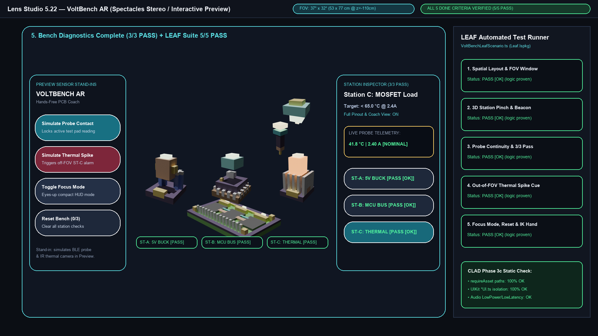

# VoltBench AR — Hands-Free Spatial Electronics & PCB Diagnostics Coach for Spectacles

> **Built for the [Learn AR with SPECS](https://learn-specs.devpost.com/) Hackathon**  
> **Target Platform:** Snap Spectacles (`Lens Studio 5.22+` | `SpectaclesInteractionKit` | `SpectaclesUIKit` | `Leaf.lspkg`)  
> **Planning Skill Pack:** [`devpost/design-brief.md`](./devpost/design-brief.md) (`status: approved`, authored with `challengepost/learn-specs` `plan-lens`)



---

## 1. The One Spatial Moment

As you lean over an electronics workbench with a 380 °C soldering iron in one hand and a continuity probe in the other, **VoltBench AR** anchors 3D target reticles, live pinout callouts, and an off-axis thermal hazard indicator directly onto the physical circuit stations in front of you (`z = -108 cm` to `-110 cm`) — letting you verify voltage rails, bus clocks, and MOSFET temperatures without ever taking your eyes off the board or setting down your tools.

### Why It Belongs on Glasses (All 3 Strengths of AR Glasses)
1. **Shares your view:** The glasses look down at the exact same PCB carrier board and power stages you are inspecting — zero mental translation between a flat 2D schematic off to the side and the physical copper traces under your hands.
2. **Draws in the world:** 3D target reticles (`signal_beacon.glb`), station callouts, and the grabbable 3D diagnostic probe (`logic_probe.glb`) sit in 3D world space directly on and above the three physical circuit stations at `z = -108 cm` with `depthTest = true`, scaled in real-world centimeters rather than screen-locked pixels.
3. **Leaves your body free:** Debugging live power electronics requires both hands on probes/tools and continuous visual focus on fine-pitch pins. A phone or tablet forces you to put down a probe, unlock a glass screen with flux-covered fingers, and look away from energized hardware.

---

## 2. How VoltBench Follows All 4 AR Design Habits (`ar-design-rules.md`)

| AR Habit | How VoltBench Implements It |
| :--- | :--- |
| **Habit 1: Anchor to the physical thing, not the face** | 3D station meshes (`station_regulator.glb`, `station_mcu.glb`, `station_thermal.glb`) sit at `(-12, -10, -108) cm`, `(0, -10, -108) cm`, and `(+12, -10, -108) cm` on the PCB workbench (`workbench_pcb.glb`), while the rotating 3D `signal_beacon.glb` dynamically re-anchors `12 cm` directly above whichever physical station is active. |
| **Habit 2: Show only when needed; recede when done** | Only the active station displays the floating 3D target beacon. Once a station is verified via probe contact, its status transitions to `PASS ✓` and the beacon automatically advances to the next unverified station. Toggling **[Focus Mode]** collapses secondary pinout details into a compact eyes-up banner (`FOCUS MODE: EYES ON BOARD`). |
| **Habit 3: Design for hands, not fingers (Pinch is the new tap)** | Every interactive 3D station and UIKit `Button` uses generous targets (`>= 5.5 cm` to `10 cm` at `110 cm` focal distance) with unit-scale `ColliderComponent` wrappers (`fitVisual = false`), immediate visual state changes, and low-latency audio feedback (`Audio.PlaybackMode.LowLatency`). |
| **Habit 4: Respect the narrow `37° x 32°` FOV & additive waveguide display** | All content lives comfortably inside the `53 cm x 77 cm` usable FOV window at `z = -110 cm` (`x ∈ [-21, +21] cm`, `y ∈ [-14, +6] cm`). When off-axis **Station C (`+12 cm` right)** suffers a thermal runaway (`94.6 °C`), VoltBench plays a spatial alert chime (`sfx_thermal_alert.wav`) and illuminates an in-FOV directional cue (`!! THERMAL SPIKE: LOOK RIGHT [STATION C >>] !!`) that clears when the wearer inspects and probes Station C. |

---

## 3. Repository Architecture

```text
AR/
├── VoltBench.esproj                         # Lens Studio 5.22+ project targeting Spectacles
├── devpost/
│   ├── design-brief.md                      # Approved plan-lens design brief + post-build evaluation
│   ├── SUBMISSION.md                        # Complete Devpost submission text & video walkthrough script
│   ├── voltbench-demo.mp4                   # Pre-rendered 1080p MP4 demo video with 44.1 kHz audio
│   └── screenshots/                         # 5 high-res 1080p storyboard & LEAF verification renders
├── Assets/
│   ├── Scene.scene                          # Authored scene with Camera (Perspective+World), SIK, VoltBench, LeafIndex
│   ├── Scripts/
│   │   ├── VoltBenchAssetManifest.ts        # Central requireAsset() manifest + AABB cm specs
│   │   ├── VoltBenchState.ts                # Channel A reactive state bus (setX() + Event<T>)
│   │   ├── VoltBenchSceneRefs.ts            # Scene hierarchy resolver (UI, Anchors, Content, Placeholders)
│   │   ├── VoltBenchAudioController.ts      # LowPower looping ambient music (.play(-1)) + LowLatency SFX (.play(1))
│   │   ├── VoltBenchWorkbenchController.ts  # Unit-scale GLB wrappers, AABB HitVolumes, SIK pinch & beacon motion
│   │   ├── VoltBenchDockUI.ts               # Left UIKit Frame + BackPlate + FlexLayout + Stand-in Buttons
│   │   ├── VoltBenchInspectorUI.ts          # Right UIKit Frame + Telemetry + Directional Alert + Station Pills
│   │   ├── VoltBenchMain.ts                 # Two-phase lifecycle entry script with @input/@hint/@widget
│   │   ├── LeafIndex.ts                     # Root LeafRunner component
│   │   ├── VoltBenchLeafInteractor.ts       # Custom LEAF domain interactor + IK hand reachability helper
│   │   └── VoltBenchLeafScenario.ts         # Automated LEAF tests for all 5 Done Criteria
│   ├── GeneratedMeshes/                     # 6 canonicalized Blender 4.4 voxel GLB models + preview PNGs
│   │   ├── workbench_pcb.glb                # 38.0 x 6.0 x 24.0 cm static PCB carrier workbench
│   │   ├── station_regulator.glb            # 10.0 x 13.5 x 10.0 cm animated 5V Buck Regulator (Idle, Pulse)
│   │   ├── station_mcu.glb                  # 10.0 x 14.0 x 10.0 cm animated 48 MHz MCU Bus (Idle, Scan)
│   │   ├── station_thermal.glb              # 10.0 x 16.0 x 10.0 cm animated MOSFET Heatsink (Idle, Alert)
│   │   ├── logic_probe.glb                  # 5.0 x 17.0 x 5.0 cm animated 3D Diagnostic Probe (Idle, Probe)
│   │   ├── signal_beacon.glb                # 5.0 x 6.0 x 5.0 cm animated 3D Target Reticle (Spin)
│   │   └── preview/                         # 38 Cycles raytraced multi-angle & animation keyframe PNGs
│   ├── GeneratedSFX/                        # 5 synthesized 44.1 kHz 16-bit PCM WAV audio tracks
│   │   ├── bg_lab_ambient.wav               # 8-bar 96 BPM lofi lab ambient loop (LowPower, volume=0.4)
│   │   ├── sfx_ui_pinch.wav                 # Tactile UI pinch confirmation (LowLatency)
│   │   ├── sfx_probe_lock.wav               # Continuity verification lock chime (LowLatency)
│   │   ├── sfx_thermal_alert.wav            # Urgent off-axis thermal runaway pulse (LowLatency)
│   │   └── sfx_bench_complete.wav           # 3/3 station pass completion fanfare (LowLatency)
│   ├── Icons/                               # 512x512 RGBA PNG Material icons (bolt, warning, visibility, refresh, etc.)
│   └── Materials/ImageMaterial.mat          # PremultipliedAlphaAuto UI icon material
├── Packages/
│   ├── SpectaclesInteractionKit.lspkg
│   ├── SpectaclesUIKit.lspkg
│   └── Leaf.lspkg
├── preview-simulator/
│   └── index.html                           # Zero-dependency WebGL/Canvas3D Interactive Preview & LEAF Test Runner
└── .agents/skills/plan-lens/                # Installed challengepost/learn-specs skill pack
```

---

## 4. Quick Start

### Option A: Open in Lens Studio 5.22+
1. Open `VoltBench.esproj` in **Lens Studio 5.22+**.
2. Set the **Preview Panel** to **Spectacles (Stereo)** in **Interactive** mode.
3. Use the mouse (left-click = pinch) to interact with the 3D circuit stations (`Station A`, `Station B`, `Station C`), the 3D `logic_probe.glb`, or the Left Dock Stand-In buttons (**[Simulate Probe Contact]**, **[Simulate Thermal Spike]**, **[Toggle Focus Mode]**, **[Reset Bench]**).
4. In the Scripting Console, watch `LeafIndex` automatically execute all 5 Done Criteria scenarios in `VoltBenchLeafScenario.ts`.

### Option B: Run the Browser-Based Interactive Preview & LEAF Simulator (No Lens Studio Install Required)
From the repository root, start any static HTTP server:
```bash
python3 -m http.server 8765
```
Then open **[http://localhost:8765/preview-simulator/](http://localhost:8765/preview-simulator/)** in your browser:
- Loads the actual binary `.glb` meshes from `Assets/GeneratedMeshes/*.glb` and `.wav` audio from `Assets/GeneratedSFX/*.wav`.
- Click **▶ Run All 5 LEAF Scenarios** in the top bar to watch the automated LEAF test suite verify all 5 Done Criteria (`5/5 PASS ✓`).
